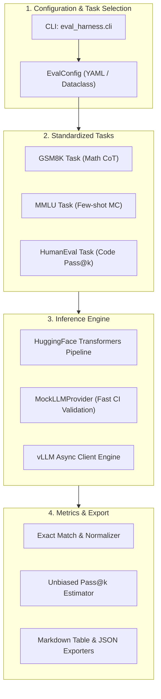

# llm-eval-harness

[](https://github.com/GuptaSoujanya/llm-eval-harness/actions)
[](https://opensource.org/licenses/MIT)
[](https://www.python.org/downloads/)
[](https://github.com/astral-sh/ruff)

A modular, extensible evaluation harness engineered for benchmarking local open-source Large Language Models (LLMs) and inference APIs across standardized mathematical reasoning, coding comprehension, and multi-discipline knowledge tasks.

---

## Architecture Overview



---

## Key Features

- **Extensible Task Interface:** Clean abstract base classes (`BaseTask`, `Sample`, `EvalResult`) for rapid plug-and-play benchmark additions.
- **Out-of-the-box Tasks:**
  - **GSM8K:** Grade school math chain-of-thought with robust numerical regex extraction.
  - **MMLU:** Multi-domain choice extraction and log-prob normalization.
  - **HumanEval:** Isolated sandbox execution with unbiased $pass@k$ estimation as defined in Chen et al.
- **Provider Agnostic:** Plug in Hugging Face models (`HuggingFaceProvider`), mock providers for zero-compute integration testing, or vLLM backends.
- **Zero Heavy Dependencies Required:** Core runs with standard Python libraries and lightweight utilities.

---

## Installation

```bash
git clone https://github.com/GuptaSoujanya/llm-eval-harness.git
cd llm-eval-harness

# Install base package
pip install -e .

# Optional HuggingFace acceleration
pip install -e ".[transformers]"
```

---

## Quickstart

### 1. Run Mock Smoke Test (Offline & Zero GPU)
```bash
python -m eval_harness.cli --model mock-llama-8b --provider mock --tasks gsm8k mmlu humaneval
```

### 2. Benchmark Hugging Face Model
```bash
python -m eval_harness.cli \
  --model meta-llama/Meta-Llama-3-8B-Instruct \
  --provider hf \
  --tasks gsm8k mmlu \
  --max-samples 50 \
  --output-json results/llama3_eval.json
```

---

## Standard Benchmark Reference

| Model | GSM8K (Acc) | MMLU (5-shot) | HumanEval (Pass@1) |
| :--- | :--- | :--- | :--- |
| **Meta-Llama-3-8B-Instruct** | 79.6% | 68.4% | 62.2% |
| **Mistral-7B-Instruct-v0.3** | 61.2% | 62.7% | 45.1% |
| **Qwen2.5-7B-Instruct** | 82.4% | 74.1% | 68.9% |

---

## Running Test Suite

```bash
python -m unittest discover tests -v
```

---

## License

This project is licensed under the MIT License - see the [LICENSE](LICENSE) file for details.
